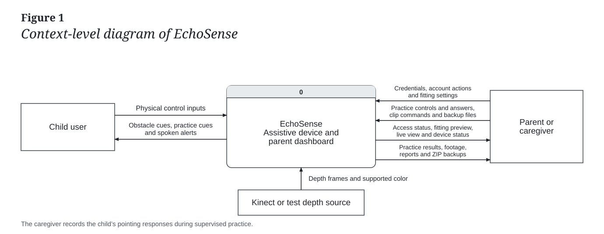

# EchoSense system diagrams and comparison

## Figure 1. Context-level diagram

The context diagram treats the assistive device and parent dashboard as a single system. The sensor provides depth frames and supported color. EchoSense sends cues and spoken alerts to the child. The parent or caregiver manages access and fitting, supervises training, enters the child’s pointing responses, and reviews footage and reports.

## Figure 2. Level 1 data-flow diagram

| Process | What it does | Main data store |
|---|---|---|
| 1.0 Authenticate and manage access | Verifies logins and invitations, resolves permissions, and issues or revokes sessions. | D1 · Device SQLite |
| 2.0 Configure child fitting | Uses measurements and optional floor calibration to preview coverage and save the fitting. | D2 · Device settings JSON |
| 3.0 Process sensing and render cues | Turns depth measurements into obstacle and drop-off detections, selects live or training cues, and streams live views and device status. | Reads fitting from 2.0 |
| 4.0 Run supervised practice | Plays virtual targets, records caregiver-entered responses, and pauses on loss of supervision. Confirmed results feed progress reporting. | D3 · Device SQLite |
| 5.0 Manage footage, backups and reports | Captures clips and snapshots in the browser, links them to practice, produces reports, and exports or restores backups. | D4 · Browser IndexedDB and recovery drafts |

See the [whole-system operational flowchart](system-flowchart.md) for decision paths, faults, and recovery.

## Figure 3. Context-level diagram of NOA by biped.ai

This reconstruction places the NOA vest, companion app, and paired audio output inside one system boundary. The wearer supplies button commands, settings, and destinations. The system returns spatial obstacle alerts, spoken navigation, and scene descriptions. Google Maps and Google Gemini represent the external services identified by biped.ai. The arrows show functional exchanges at the system boundary. [NOA user manual](https://biped.ai/en/user-manual), [NOA orientation and mobility guide](https://www.biped.ai/en/o-m-guide/), [NOA product overview](https://biped.ai/).

## Table 1. Comparison of EchoSense and similar systems

Each system is checked on six features. A feature column is kept only where EchoSense offers it.

| System | Detects obstacles | Head-level warning | Spatial sound | Hands-free | Works without a phone | Training mode |
| --- | :---: | :---: | :---: | :---: | :---: | :---: |
| **EchoSense (proposed)** | ✓ | ✓ | ✓ | ✓ | ✓ | ✓ |
| Sound of Vision [1] | ✓ | ✓ | ◐ | ✓ | ✓ | ✓ |
| The vOICe [2] | ◐ | ◐ | ◐ | ◐ | ✓ | ✓ |
| [NOA by biped.ai [3]](#figure-3-context-level-diagram-of-noa-by-bipedai) | ✓ | ✓ | ◐ | ✓ | ✗ | ✗ |
| .lumen Glasses [4] | ✓ | ✓ | ✗ | ✓ | ✗ | ✗ |
| WeWALK Smart Cane 2 [5] | ✓ | ✓ | ✗ | ✗ | ✓ | ✗ |
| UltraCane [6] | ✓ | ✓ | ✗ | ✗ | ✓ | ✗ |
| Glide by Glidance [7] | ✓ | ✓ | ✗ | ✗ | ✓ | ✗ |
| Alcasid et al. (2022) [8] | ✓ | ✓ | ✗ | ◐ | ◐ | ✗ |
| Malubay et al. (2024) [9] | ✓ | ◐ | ✗ | ✗ | ✓ | ✗ |
| OrCam MyEye [10] | ✗ | ✗ | ✗ | ✓ | ✓ | ✗ |
| Envision Glasses [11] | ✗ | ✗ | ✗ | ✓ | ◐ | ✗ |
| Apple Magnifier Detection Mode [12] | ✓ | ✗ | ✗ | ✗ | ✗ | ✗ |
| Microsoft Soundscape [13] | ✗ | ✗ | ◐ | ◐ | ✗ | ✗ |
| Be My Eyes / Be My AI [14] | ✗ | ✗ | ✗ | ◐ | ✗ | ✗ |
| Seeing AI [15] | ✗ | ✗ | ✗ | ✗ | ✗ | ✗ |
| Google Lookout [16] | ✗ | ✗ | ✗ | ✗ | ✗ | ✗ |
| Lazarillo [17] | ✗ | ✗ | ✗ | ✗ | ✗ | ✗ |
| BlindSquare [18] | ✗ | ✗ | ✗ | ✗ | ✗ | ✗ |

✓ = offered and documented in the cited source. ◐ = offered in a limited form. ✗ = not offered, or not documented in the sources reviewed. EchoSense marks describe its designed functions, which are not yet field-tested. For Alcasid et al. and Malubay et al., only the abstracts were reviewed. [Download the vector table](figures/echosense-comparison.svg).

## Table 2. Hardware of EchoSense and the closest depth-sensing systems

| System | Depth Sensor | Processing Unit | Worn or Carried | Obstacle Feedback |
| --- | --- | --- | --- | --- |
| **EchoSense (proposed)** | Microsoft Kinect v2 time-of-flight camera [23] | Orange Pi single-board computer | Chest harness | HRTF-based 3D spatial audio through open-ear output |
| Lucio-Naranjo et al. (2026) [19] | ZED stereo camera | NVIDIA Jetson TX module | Chest, in a vest | 3D audio through headphones |
| Wahyudi et al. (2025) [20] | Arducam time-of-flight camera | Raspberry Pi 4B | Head | HRTF spatial audio at 7 directions and 3 heights |
| Gao et al. (2025) [21] | Camera capturing video and depth | FPGA board in the glasses, with a smartphone running detection | Head, as glasses | Audio and tactile alerts |
| See et al. (2022) [22] | Time-of-flight depth camera of a smartphone | Smartphone | Held in the hand | Audio feedback |
| NOA by biped.ai [3] | Wide-angle cameras with depth estimation | On-board computer in the vest | Shoulders, as a vest | Directional sound through bone-conduction headphones |
| .lumen Glasses [4] | Infrared stereo camera pairs | On-device processing in the headset | Head, as a headset | Haptic guidance on the forehead, with voice |
| Glide by Glidance [7] | Infrared-enhanced stereo depth cameras | Built into the device | Pushed on wheels, held by a handle | Steering, haptic and audio cues |

EchoSense is closest in design to Lucio-Naranjo et al. (2026), which also carries its depth camera on the chest and renders obstacles as 3D audio, and to Wahyudi et al. (2025), which pairs a time-of-flight camera with HRTF-based spatial audio on a single-board computer.

## Figure 4. Features offered by EchoSense and similar systems

Counts the six features in Table 1, with ◐ counted as 0.5. The hatched bar marks EchoSense as proposed and not yet field-tested.

### Sources

1. Zvorișteanu, O., et al. (2021). Sensory substitution for the visually impaired: A study on the usability of the Sound of Vision system in outdoor environments. *Electronics, 10*(14), 1619. [https://doi.org/10.3390/electronics10141619](https://doi.org/10.3390/electronics10141619)
2. Meijer, P. B. L. (n.d.). The vOICe for Android, and The vOICe Training Manual. [https://www.seeingwithsound.com/android.htm](https://www.seeingwithsound.com/android.htm)
3. biped.ai. (n.d.). NOA product overview and orientation and mobility guide. [https://www.biped.ai/en/o-m-guide/](https://www.biped.ai/en/o-m-guide/)
4. .lumen. (n.d.). .lumen glasses. [https://www.dotlumen.com/glasses](https://www.dotlumen.com/glasses)
5. WeWALK. (n.d.). Smart Cane 2 user manual. [https://support.wewalk.io/en/article/wewalk-smart-cane-2-users-manual/](https://support.wewalk.io/en/article/wewalk-smart-cane-2-users-manual/)
6. Sound Foresight Technology. (n.d.). UltraCane. [https://livingmadeeasy.org.uk/product/ultracane](https://livingmadeeasy.org.uk/product/ultracane)
7. Glidance. (n.d.). Glide product page and FAQ. [https://www.glidance.io/](https://www.glidance.io/)
8. Alcasid, V. D. Q., Lawas, M. M. L., & Manguera, J. M. T. (2022). Integrated assistive tools for the blind with obstacle collision detection, GPS tracker and video recording. *Ani: Letran Calamba Research Report, 18*(1). [https://ejournals.ph/article.php?id=19028](https://ejournals.ph/article.php?id=19028)
9. Malubay, J. C., Buban, M. G. A., Beninsig, M. A., & Tandingan, D. R., Jr. (2024). Prototype using ultrasonic sensor to assist visually impaired individual in the Philippines. *IJRITCC, 12*(2), 227–230. [https://ijritcc.org/index.php/ijritcc/article/view/10557](https://ijritcc.org/index.php/ijritcc/article/view/10557)
10. OrCam Technologies. (n.d.). OrCam MyEye. [https://thelowvisionstore.com/products/orcam-myeye-2](https://thelowvisionstore.com/products/orcam-myeye-2)
11. Envision. (n.d.). Envision Glasses. [https://www.letsenvision.com/glasses/home](https://www.letsenvision.com/glasses/home)
12. Apple Inc. (n.d.). Detect doors, people, and furniture around you using Magnifier on iPhone. [https://support.apple.com/guide/iphone/detect-doors-around-you-iph35c335575/ios](https://support.apple.com/guide/iphone/detect-doors-around-you-iph35c335575/ios)
13. Microsoft Research. (n.d.). Microsoft Soundscape. [https://www.microsoft.com/en-us/research/product/soundscape/](https://www.microsoft.com/en-us/research/product/soundscape/)
14. Be My Eyes. (n.d.). Be My Eyes. [https://www.bemyeyes.com/](https://www.bemyeyes.com/)
15. Microsoft. (n.d.). Seeing AI. [https://www.seeingai.com/](https://www.seeingai.com/)
16. Google. (n.d.). Lookout: Assisted vision. [https://play.google.com/store/apps/details?id=com.google.android.apps.accessibility.reveal](https://play.google.com/store/apps/details?id=com.google.android.apps.accessibility.reveal)
17. Lazarillo App. (n.d.). Lazarillo. [https://lazarillo.app/](https://lazarillo.app/)
18. BlindSquare Oy. (n.d.). BlindSquare. [https://www.blindsquare.com/](https://www.blindsquare.com/)
19. Lucio-Naranjo, J. F., et al. (2026). Assisted navigation for visually impaired people using 3D audio and stereoscopic cameras. *Applied Sciences, 16*(9), 4405. [https://doi.org/10.3390/app16094405](https://doi.org/10.3390/app16094405)
20. Wahyudi, W., et al. (2025). Mobility aid for the visually impaired using machine learning and spatial audio. *Journal of Robotics and Control, 6*(2), 779–797. [https://doi.org/10.18196/jrc.v6i2.25245](https://doi.org/10.18196/jrc.v6i2.25245)
21. Gao, Y., et al. (2025). A wearable obstacle avoidance device for visually impaired individuals with cross-modal learning. *Nature Communications, 16*, 2857. [https://doi.org/10.1038/s41467-025-58085-x](https://doi.org/10.1038/s41467-025-58085-x)
22. See, A. R., Sasing, B. G., & Advincula, W. D. (2022). A smartphone-based mobility assistant using depth imaging for visually impaired and blind. *Applied Sciences, 12*(6), 2802. [https://doi.org/10.3390/app12062802](https://doi.org/10.3390/app12062802)
23. Kurillo, G., et al. (2022). Evaluating the accuracy of the Azure Kinect and Kinect v2. *Sensors, 22*(7), 2469. [https://doi.org/10.3390/s22072469](https://doi.org/10.3390/s22072469)
