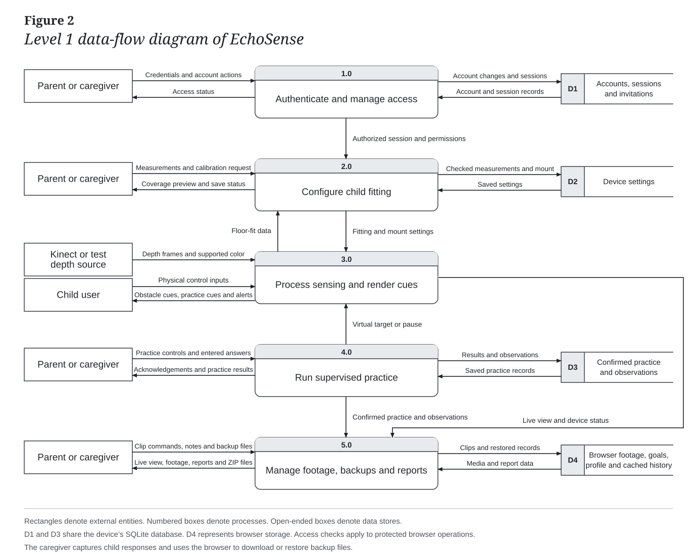
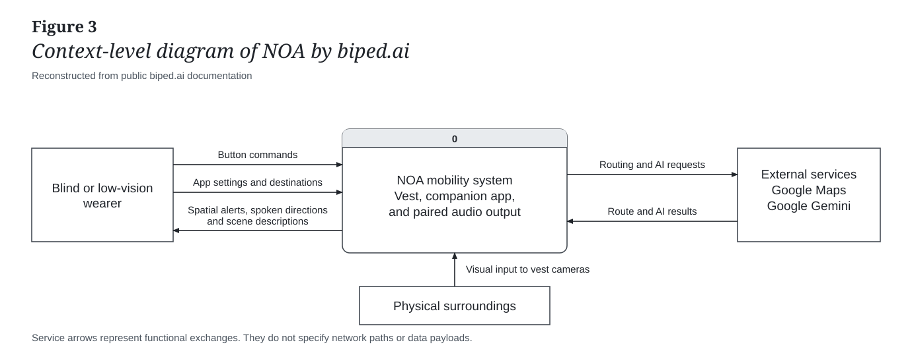

# EchoSense system diagrams and comparison

## Figure 1. Context-level diagram

The context diagram treats the assistive device and parent dashboard as a single system. The sensor provides depth frames and supported color. EchoSense sends cues and spoken alerts to the child. The parent or caregiver manages access and fitting, supervises training, enters the child’s pointing responses, and reviews footage and reports.

## Figure 2. Level 1 data-flow diagram

| Process | What it does | Main data store |
|---|---|---|
| 1.0 Authenticate and manage access | Verifies logins and invitations, resolves permissions, and issues or revokes sessions. | D1 · Device SQLite |
| 2.0 Configure child fitting | Uses measurements and optional floor calibration to preview coverage and save the fitting. | D2 · Device settings JSON |
| 3.0 Process sensing and render cues | Turns depth measurements into obstacle and drop-off detections, selects live or training cues, and streams live views and device status. | Reads fitting from 2.0 |
| 4.0 Run supervised practice | Plays virtual targets, records caregiver-entered responses, and pauses on loss of supervision. Confirmed results feed progress reporting. | D3 · Device SQLite |
| 5.0 Manage footage, backups and reports | Captures clips and snapshots in the browser, links them to practice, produces reports, and exports or restores backups. | D4 · Browser IndexedDB and recovery drafts |

See the [whole-system operational flowchart](system-flowchart.md) for decision paths, faults, and recovery.

## Figure 3. Context-level diagram of NOA by biped.ai

This reconstruction places the NOA vest, companion app, and paired audio output inside one system boundary. The wearer supplies button commands, settings, and destinations. The system returns spatial obstacle alerts, spoken navigation, and scene descriptions. Google Maps and Google Gemini represent the external services identified by biped.ai. The arrows show functional exchanges at the system boundary. [NOA user manual](https://biped.ai/en/user-manual), [NOA orientation and mobility guide](https://www.biped.ai/en/o-m-guide/), [NOA product overview](https://biped.ai/).

## Table 1. Comparison of EchoSense and related assistive tools

| System | Detect nearby obstacles | Play spatial obstacle alerts | Give turn-by-turn route directions | Read printed text aloud | Log supervised practice results | Record caregiver review clips | Export practice reports | Restore records from a backup |
| --- | :---: | :---: | :---: | :---: | :---: | :---: | :---: | :---: |
| **EchoSense prototype** | ✓ | ✓ | ✗ | ✗ | ✓ | ✓ | ✓ | ✓ |
| [NOA by biped.ai [1]](#figure-3-context-level-diagram-of-noa-by-bipedai) | ✓ | ✓ | ✓ | ✓ | ✗ | ✗ | ✗ | ✗ |
| WeWALK Smart Cane 2 [2] | ✓ | ✗ | ✓ | ✗ | ✗ | ✗ | ✗ | ✗ |
| Microsoft Seeing AI [3] | ✗ | ✗ | ✗ | ✓ | ✗ | ✗ | ✗ | ✗ |
| Lazarillo [4] | ✗ | ✗ | ✓ | ✗ | ✗ | ✗ | ✗ | ✗ |

✓ = documented or implemented. ✗ = unavailable in the EchoSense prototype or unverified in the cited materials for the other tools. [Download the vector table](figures/echosense-comparison.svg).

1. biped.ai. [NOA product overview](https://biped.ai/) and [orientation and mobility guide](https://www.biped.ai/en/o-m-guide/).
2. WeWALK. [Smart Cane 2 user manual](https://support.wewalk.io/en/article/wewalk-smart-cane-2-users-manual/).
3. Microsoft. [Seeing AI product overview](https://www.microsoft.com/en-us/garage/wall-of-fame/seeing-ai/).
4. Lazarillo. [Lazarillo App overview](https://lazarillo.app/theapp/).
