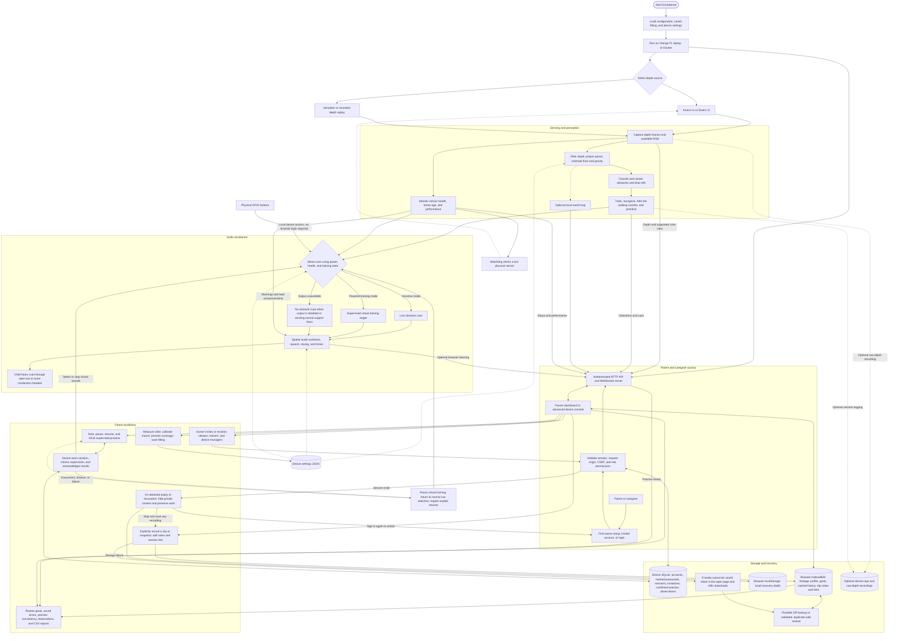
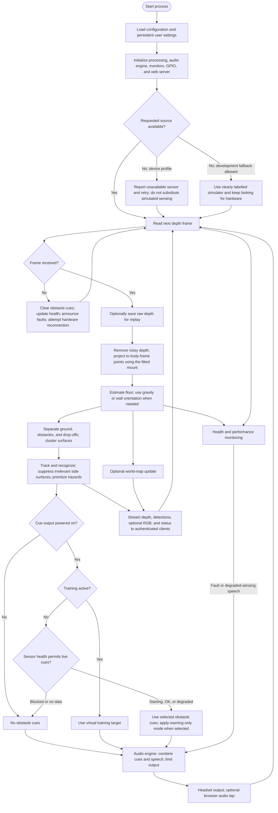
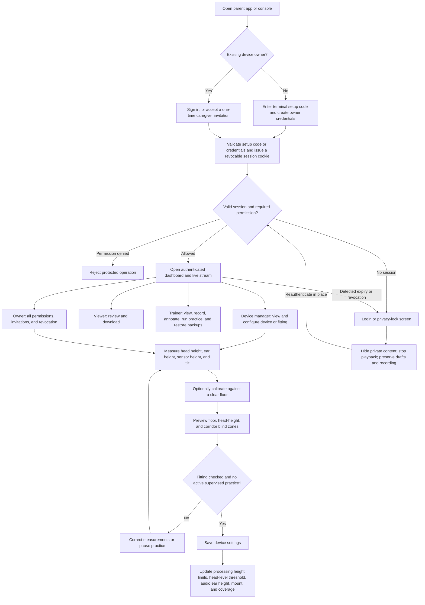
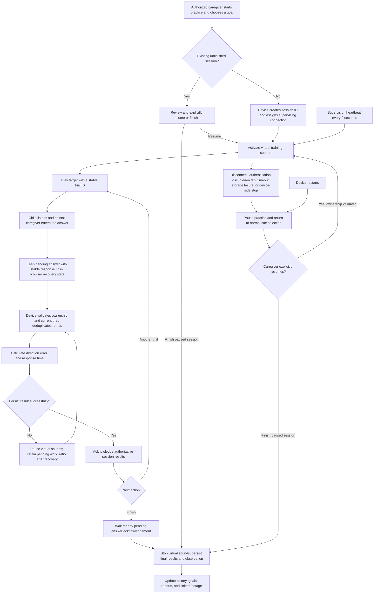
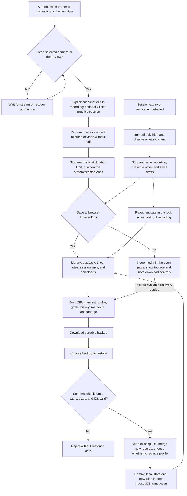

# EchoSense whole-system flowchart

This maps the implemented system, including the device pipeline, authenticated parent app, supervised training, child fitting, recordings, reports, and recovery. The same software runs on an Orange Pi, a laptop, or Docker; the selected depth source and audio output differ.

Solid arrows show the main flow. Dotted arrows show optional processing, saved configuration, or recovery/control relationships. The diagrams describe software behavior, not clinical validation or guaranteed obstacle detection.

## Whole-system overview

## Startup and live assistance

Sensing continues while the user-facing cue output is off. Degraded sensing can continue to produce live cues while announcing a warning. The hardware watchdog runs alongside the frame loop. Battery percentages and battery warnings currently use the simulated battery model.

## Login, permissions, and child fitting

Authenticated HTTP mutations also check origin and a session-bound CSRF token. WebSocket upgrades check origin and authentication; device commands check permissions. Physical device buttons are local controls, independent of browser login. Password recovery is available from the device terminal.

## Supervised training and reliable results

The supervision timeout is 10 seconds, checked by a watchdog every 0.5 seconds. A lost supervising WebSocket pauses on disconnect. Results, observations, and active-time checkpoints are stored on the device. A retry after a lost acknowledgement cannot add the same response twice. Training errors describe the sound exercise, not overall mobility or safety.

## Recording, backup, and privacy recovery

A browser recording is separate from the device's optional raw-depth `.esd` recording. Kinect v2 currently supplies depth through its bridge; Kinect v1 and the simulator can also supply color. ZIP restore writes browser data only: it does not restore accounts, passwords, device fitting, or control authority. Imported unfinished practice is archived history, not a live session. Browser storage failure can leave footage only in page memory until it is downloaded.

## Storage and implementation map

| Location | Contents | Main implementation |
|---|---|---|
| Device `accounts.sqlite3` | Users, password hashes, roles, invitations, authenticated sessions, confirmed practice/results/observations | `echosense/auth.py`, `echosense/device/supervision.py` |
| Device settings JSON | Power/audio preferences, measured child heights, mount geometry, fitting flag | `echosense/device/settings.py`, `echosense/app.py` |
| Browser IndexedDB | Footage, profile, goals, cached history, clip metadata and session links | `echosense/web/parent-data.mjs`, `echosense/web/parent.js` |
| Browser localStorage | Small emergency draft records when available | `echosense/web/parent.js` |
| Open-page memory | Unsaved media recovery copies while storage is unavailable | `echosense/web/parent.js` |
| Downloaded ZIP/CSV/media | Portable backups, reports, and exported footage | `echosense/web/parent-data.mjs`, `echosense/web/parent-progress.mjs` |
| Optional device logs / `.esd` files | Operational session logs and replayable raw depth | `echosense/device/monitors.py`, `echosense/sensors/replay.py` |

The overall coordinator is `echosense/app.py`; `echosense/server.py` serves the authenticated app and transports live data and commands. There is currently no cloud storage, GPS tracking, or internet relay in this system. Public GitHub hosts the software source, not the child's live footage or account database.

The standalone overview source is [system-flowchart.mmd](system-flowchart.mmd). GitHub renders each Mermaid block in this document. See [parent workflows](parent-dashboard.md) and [account and permission details](authentication.md) for operating instructions.
